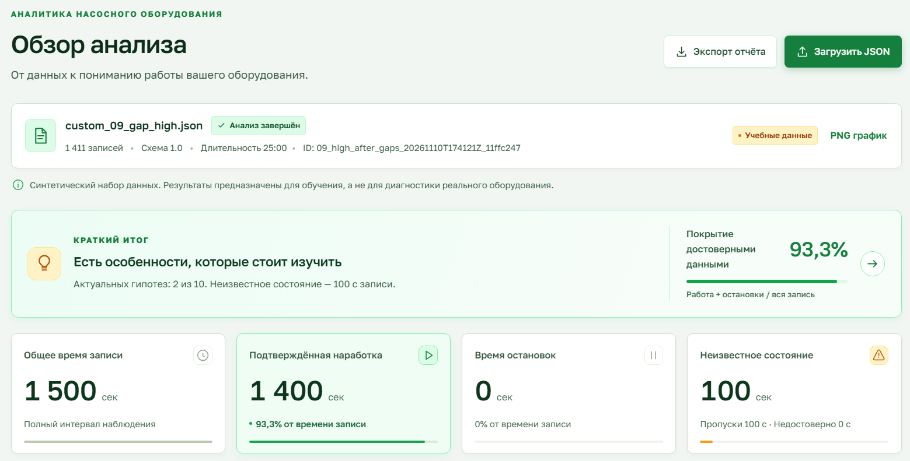
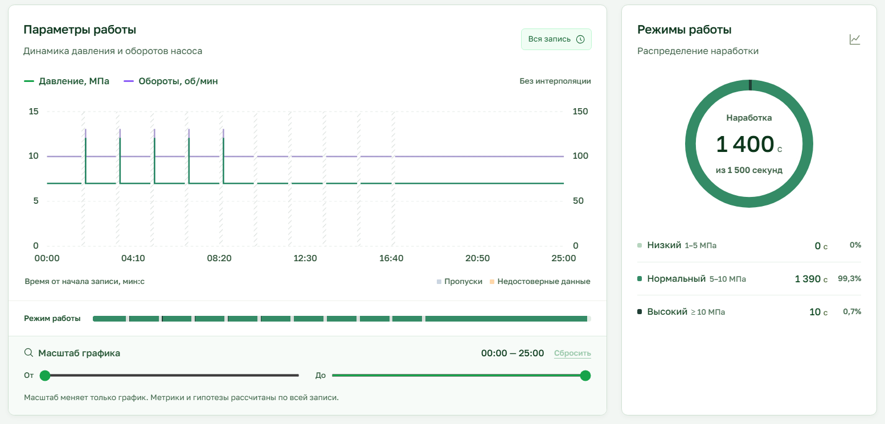
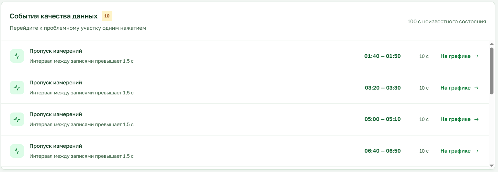
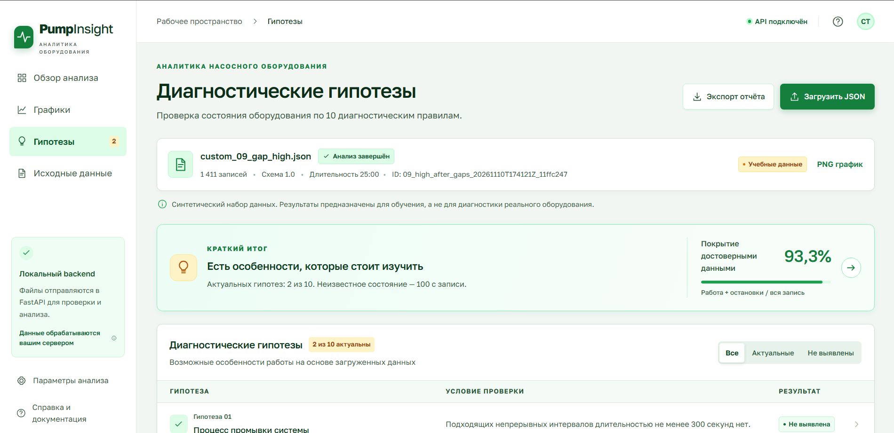

# 4k-1s-SSDU-Group_project-Pump_controller
# Pump Analyzer — Веб-приложение для анализа данных насоса

**Групповой проект по ССДУ (Системы сбора и обработки данных)**

Веб-приложение для анализа данных датчиков насоса. Система принимает JSON-файлы с показаниями давления и оборотов, проверяет формат данных, классифицирует интервалы работы, рассчитывает метрики наработки и времени остановок, визуализирует результаты и проверяет 10 диагностических гипотез.

> ⚠️ **Важно:** Это учебный прототип. Пороговые значения и гипотезы предназначены для анализа подготовленных записей, а не для безопасного управления насосом или подтверждения неисправности реального оборудования.

---

## 📑 Оглавление

- [Стек технологий](#стек-технологий)
- [Структура проекта](#структура-проекта)
- [Установка и запуск](#установка-и-запуск)
- [HTTP API](#http-api)
- [Формат входных данных](#формат-входных-данных)
- [Бизнес-правила классификации](#бизнес-правила-классификации)
- [Итоговые метрики](#итоговые-метрики)
- [Диагностические гипотезы](#диагностические-гипотезы)
- [Тестирование](#тестирование)
- [Обработка ошибок](#обработка-ошибок)
- [Примеры использования](#примеры-использования)
- [Конфигурация](#конфигурация)
- [Скриншоты](#скриншоты)

---

## Стек технологий

### Backend (Python)
- **Python 3.10+**
- **FastAPI**
- **Uvicorn**
- **Pydantic**
- **python-multipart**
- **Matplotlib**
- **NumPy**

### Frontend (TypeScript/React)
- **Node.js & npm**
- **React**
- **TypeScript**
- **Vite**
- **Axios**

### Инструменты разработки
- **unittest**
- **Git**

---

## Структура проекта

```
pump_analyzer/
├── app/                              # Backend приложение (Python/FastAPI)
│   ├── __init__.py                   # Инициализация пакета
│   ├── main.py                       # Точка входа FastAPI + middleware + логирование
│   ├── core.py                       # Ядро: валидация + классификация + расчёты + гипотезы
│   ├── endpoints.py                  # HTTP endpoints (API маршруты)
│   ├── output_manager.py             # Сохранение результатов в output/
│   └── visualization.py              # Построение графиков matplotlib
│
├── frontend/                         # Frontend приложение (TypeScript/React)
│   ├── src/
│   │   ├── App.tsx                   # Основной компонент интерфейса
│   │   ├── api.ts                    # API запросы к backend
│   │   ├── analyzer.ts              # Типы данных и интерфейсы
│   │   └── analysis-view.ts         # Компоненты отображения результатов
│   ├── index.html                    # Входная точка HTML
│   ├── vite.config.ts               # Конфигурация Vite (proxy /api → backend)
│   └── package.json                 # Frontend зависимости
│
├── tests/                            # Тесты backend
│   └── test_core.py                 # Модульные тесты (пункты 2-12 из инструкции)
│
├── data/                             # Тестовые данные
│   ├── 01_small.json                # Базовый тест (13 записей, пункт 10)
│   ├── 02_boundaries.json           # Граничные значения (50 об/мин, 1/5/10 МПа)
│   ├── 03_gap_20min.json            # Пропуск 20 минут (1200 сек gap)
│   ├── 04_invalid_values.json       # Недостоверные данные (null, negative, valid=false)
│   ├── 05_long_record.json          # Длинная запись (1742 точки, 1800 сек)
│   ├── 06_empty.json                # Пустой массив (пункт 5a)
│   ├── 07_single_point.json         # Одна точка (пункт 5b)
│   └── format_errors/               # Файлы с ошибками формата
│       ├── 08_missing_rpm.json      # Отсутствует поле rpm
│       ├── 09_wrong_type.json       # Строка вместо числа
│       └── 10_duplicate_time.json   # Повтор времени
│
├── output/                           # Результаты анализа (создается автоматически)
│   └── {result_id}/                 # Папка для каждого анализа
│       ├── analysis.json            # Полный результат анализа
│       ├── graphs/
│       │   └── pressure_rpm.png     # График давления и оборотов
│       └── hypotheses/
│           ├── hypothesis_01.json   # Результат гипотезы 1
│           ├── hypothesis_02.json   # Результат гипотезы 2
│           └── ...                  # До hypothesis_10.json
│
├── pyproject.toml                    # Зависимости Python и метаданные проекта
├── README.md                         # Документация проекта
└── README-фронтенд.md               # Документация frontend
```

---

## Установка и запуск

### Предварительные требования
- **Python 3.10** или новее
- **Node.js 18+** и **npm 9+**
- **Git** (опционально)

### 1. Установка Backend зависимостей

```bash
# Создание виртуального окружения
python -m venv .venv

# Активация виртуального окружения
# Windows:
.venv\Scripts\Activate.ps1
# Linux/Mac:
source .venv/bin/activate

# Установка зависимостей
pip install .
```

### 2. Запуск Backend сервера

```bash
# Из корневой папки проекта
uvicorn app.main:app --reload --port 8000
```

Сервер запустится на **http://localhost:8000**

- **http://localhost:8000** — проверка доступности API
- **http://localhost:8000/docs** — Swagger UI (интерактивная документация API)
- **http://localhost:8000/openapi.json** — схема OpenAPI

### 3. Установка Frontend зависимостей

Откройте **новый терминал** и выполните:

```bash
cd frontend
npm install
```

### 4. Запуск Frontend приложения

```bash
# В папке frontend
npm run dev
```

Frontend запустится на **http://localhost:8443** (или другой порт, указанный Vite)

### 5. Открытие приложения

Откройте браузер и перейдите по адресу, указанному Vite (обычно **http://localhost:8443**)

### 6. Запуск тестов

```bash
# Из корневой папки проекта
python -m unittest discover -s tests -v
```

---

## HTTP API

### `POST /api/analyze`

Загружает один JSON-файл в поле `file` формы `multipart/form-data`, проверяет данные и возвращает метрики и результаты гипотез.

**Пример в PowerShell:**
```powershell
curl.exe -X POST http://localhost:8000/api/analyze `
  -F "file=@data/01_small.json"
```

**Пример в bash:**
```bash
curl -X POST http://localhost:8000/api/analyze \
  -F "file=@data/01_small.json"
```

**Пример успешного ответа:**
```json
{
  "status": "ok",
  "schema_version": "1.0",
  "dataset_id": "01_small",
  "synthetic": true,
  "sample_count": 13,
  "span_s": 12,
  "working_s": 9,
  "stopped_s": 3,
  "gap_s": 0,
  "invalid_s": 0,
  "unknown_s": 0,
  "modes_s": {
    "low": 3,
    "normal": 3,
    "high": 3
  },
  "samples": [...],
  "intervals": [...],
  "hypotheses": [...],
  "result_id": "01_small20261111T120000Z1a2b3c4d",
  "artifacts": {
    "analysis": {
      "file": "01_small20261111T120000Z1a2b3c4d/analysis.json",
      "url": "/api/results/01_small20261111T120000Z1a2b3c4d"
    },
    "graph": {
      "file": "01_small20261111T120000Z1a2b3c4d/graphs/pressure_rpm.png",
      "url": "/api/results/01_small20261111T120000Z1a2b3c4d/graph"
    }
  }
}
```

### `GET /api/results/{result_id}`

Получить сохранённый результат анализа.

### `GET /api/results/{result_id}/graph`

Получить график давления и оборотов (PNG).

### `GET /api/results/{result_id}/hypotheses/{hypothesis_id}`

Получить JSON отдельной гипотезы.

### `GET /`

Возвращает короткий ответ для проверки доступности:
```json
{"message": "Hello, World! Hello Tiny Tim!"}
```

### Ошибки

Если файл не удовлетворяет требованиям, endpoint возвращает HTTP 422:
```json
{
  "detail": {
    "status": "format_error",
    "category": "missing_field",
    "message": "В samples[0] отсутствует поле rpm.",
    "totals": null
  }
}
```

---

## Формат входных данных

Поддерживается версия схемы `"1.0"`. Обязательные поля верхнего уровня:

| Поле | Тип | Описание |
|------|-----|----------|
| `schema_version` | строка | Версия формата; должна быть `"1.0"` |
| `dataset_id` | строка | Идентификатор записи |
| `synthetic` | boolean | Признак синтетического набора |
| `samples` | массив объектов | Последовательность показаний датчиков |

Каждый объект в `samples` должен содержать:

| Поле | Тип | Условия |
|------|-----|---------|
| `t_s` | конечное число | Секунды от начала записи; `t_s >= 0`; метки строго возрастают |
| `pressure_mpa` | конечное число или `null` | Давление в МПа |
| `rpm` | конечное число или `null` | Обороты в минуту |
| `valid` | boolean | Признак достоверности измерения |

**Пример:**
```json
{
  "schema_version": "1.0",
  "dataset_id": "example",
  "synthetic": true,
  "samples": [
    {"t_s": 0, "pressure_mpa": 6, "rpm": 100, "valid": true},
    {"t_s": 1, "pressure_mpa": 6, "rpm": 100, "valid": true}
  ]
}
```

**Правила валидации:**
- JSON читается как UTF-8 (допускается BOM)
- Дополнительные поля игнорируются
- Строки, boolean, `NaN` и бесконечности не принимаются вместо числовых значений
- Boolean в Python отдельно исключен из проверки чисел
- Дубликат или обратный порядок временных меток приводит к отказу всего файла

**Категории ошибок:**

| category | Причина |
|----------|---------|
| `invalid_json` | Ошибка синтаксиса JSON или неподходящая кодировка файла |
| `missing_field` | Не найдено обязательное поле в объекте или выборке |
| `wrong_type` | Неверный тип, структура или не конечное числовое значение |
| `unsupported_version` | Версия схемы отличается от `"1.0"` |
| `non_increasing_time` | Отрицательная, повторная или убывающая метка времени |

---

## Бизнес-правила классификации

### Как считаются интервалы

Расчеты выполняются между каждой парой соседних показаний. Интервал имеет вид `[start_s, end_s)`:
- **Длительность:** `dt = samples[i+1].t_s - samples[i].t_s`
- **Значения:** берутся из левой записи `samples[i]`
- **Последняя запись:** лишь закрывает предыдущий интервал; отдельное время после нее не добавляется
- **Время до первой записи** тоже не достраивается

### Приоритет классификации (строго по порядку)

1. **Пропуск (gap):** если `dt > 1.5` секунды
2. **Недостоверное (invalid):** при `valid=false`, `null` в давлении/оборотах или отрицательном давлении/оборотах
3. **Работа (working):** если одновременно `rpm >= 50` и `pressure_mpa >= 1`
4. **Остановка (stopped):** если условие работы не выполнено

**Важно:** при большом разрыве недостоверность значений слева отдельно не учитывается — приоритет имеет пропуск. Между обычными соседними показаниями предполагается постоянное значение левого измерения.

### Режимы работы насоса

| Режим | Условие |
|-------|---------|
| `low` (низкое) | `1 <= pressure_mpa < 5` |
| `normal` (обычное) | `5 <= pressure_mpa < 10` |
| `high` (высокое) | `pressure_mpa >= 10` |

Режим определяется только для работающих интервалов.

---

## Итоговые метрики

| Метрика | Описание | Формула |
|---------|----------|---------|
| `sample_count` | Количество записей | `len(samples)` |
| `span_s` | Общая длительность | `last_t_s - first_t_s` |
| `working_s` | Время работы | `low_s + normal_s + high_s` |
| `stopped_s` | Время остановок | Сумма stopped интервалов |
| `gap_s` | Время пропусков | Сумма gap интервалов |
| `invalid_s` | Недостоверные данные | Сумма invalid интервалов |
| `unknown_s` | Неизвестное состояние | `gap_s + invalid_s` |
| `modes_s` | Время по режимам | `{low, normal, high}` |

### Проверки корректности

```
working_s = modes_s.low + modes_s.normal + modes_s.high
span_s = working_s + stopped_s + gap_s + invalid_s
unknown_s = gap_s + invalid_s
```

Для пустого массива и одной точки все длительности равны нулю. Никакую дополнительную секунду после последней записи не прибавляем.

---

## Диагностические гипотезы

Поле `hypotheses` содержит десять результатов. Каждый результат включает:
- `id` и `title` — номер и название гипотезы
- `status` — `detected`, `not_detected` или `insufficient_data`
- `detected` — `true`, `false` или `null` соответственно
- `message` — краткое человекочитаемое пояснение
- `details` — примененный порог, рассчитанные величины, а для части проверок временные метки найденных интервалов

> ⚠️ **Важно:** Гипотезы являются лишь предположениями. Срабатывание гипотезы указывает на *аномальный паттерн в данных*, но не является окончательным диагнозом. Для подтверждения неисправности требуется осмотр оборудования специалистом.

### Гипотеза 1: Процесс промывки системы
**Условие:** Непрерывный интервал длительностью не менее 300 секунд с `pressure_mpa < 5` и `rpm >= 50`. Интервалы `gap` и `invalid` разрывают такой участок.  
**Вывод:** Для каждого найденного события возвращаются начало, конец, длительность и средние давление/обороты.

> 💡 **Что это может символизировать:**  
> Плановую технологическую промывку трубопровода. Однако, если промывка не запланирована, это может указывать на **работу «вхолостую»**, потерю подпора во всасывающей магистрали, заклинивание регулятора в открытом положении или начало **кавитации** из-за низкого давления на входе.

### Гипотеза 2: Аномальные остановки
**Условие:** `detected=true`, если `stopped_s / span_s > 0.5` (более 50% времени записи насос не работает).  
**Вывод:** В `details` возвращаются переходы между рабочими интервалами и остановками.

> 💡 **Что это может символизировать:**  
> Частые срабатывания защитной автоматики (например, теплового реле двигателя из-за перегрева), нестабильное электроснабжение, сбои в логике ПЛК (программируемого логического контроллера) или критическое несоответствие производительности насоса текущим потребностям системы (постоянное включение/выключение по датчику давления).

### Гипотеза 3: Предполагаемый износ оборудования
**Условие:** Срабатывает, если доля остановок превышает 70% (`stopped_s / span_s > 0.7`) или доля пропусков данных превышает 20% (`gap_s / span_s > 0.2`).

> 💡 **Что это может символизировать:**  
> Критическое состояние оборудования или системы мониторинга. Высокая доля остановок говорит о том, что насос практически не эксплуатируется или постоянно ломается. Высокая доля пропусков (`gap_s`) указывает на **хронические сбои линии связи**, отказ телеметрического оборудования или систематические отключения питания датчиков.

### Гипотеза 4: Недостоверные данные
**Условие:** Срабатывает, если `invalid_s / span_s > 0.2` (более 20% времени данные помечены как недостоверные). Пропуски в эту долю не входят.

> 💡 **Что это может символизировать:**  
> Деградацию или частичный отказ датчиков (дрейф нуля, зашумленный сигнал), плохой контакт в проводке, сильные электромагнитные помехи (EMI) от соседнего силового оборудования или неисправность аналого-цифрового преобразователя (АЦП) в контроллере.

### Гипотеза 5: Деградация производительности
**Условие:** Сравнивает показания с одинаковым точным значением `rpm` в первых и последних 20% временного диапазона записи. Срабатывает при снижении среднего давления более чем на 10%.  
**Метод:** Используются только точки с `valid=true`, `rpm >= 50` и `pressure_mpa >= 1`. Если общих значений оборотов нет, результат — `insufficient_data`.

> 💡 **Что это может символизировать:**  
> Постепенный **внутренний износ рабочих органов** насоса (эрозия или коррозионное разрушение рабочего колеса, износ уплотнительных колец), появление внутренних перетечек или постепенное засорение фильтров/сеток, изменяющее гидравлическое сопротивление системы.

### Гипотеза 6: Частые переключения режимов
**Условие:** Считает переходы между режимами `low`, `normal` и `high` в последовательных рабочих интервалах. Счетчик сбрасывается на остановке. Срабатывание — более 10 переходов в час.

> 💡 **Что это может символизировать:**  
> Нестабильный технологический процесс, **плохо настроенный ПИД-регулятор** (система входит в автоколебания или «охоту»), либо «дребезг» показаний датчика давления, который заставляет частотный преобразователь постоянно и хаотично менять обороты двигателя.

### Гипотеза 7: Низкое давление при высоких оборотах
**Условие:** Ищет рабочие интервалы, где `rpm >= 100` и `pressure_mpa < 5`. Срабатывает, если найден хотя бы один такой интервал.

> 💡 **Что это может символизировать:**  
> **Крупную аварию напорной магистрали** (разрыв трубы, открытая задвижка), полный отказ обратного клапана (масштабный переток среды обратно) или серьезную потерю герметичности торцевых уплотнений, из-за чего насос не может создать расчетный напор даже на высоких оборотах.

### Гипотеза 8: Длительный режим high
**Условие:** Срабатывает, если `modes_s.high / working_s > 0.5` (режим высокого давления занимает более 50% времени работы).

> 💡 **Что это может символизировать:**  
> Работу насоса **на закрытую или частично прикрытую задвижку** («deadheading»), что ведет к перегреву перекачиваемой среды и разрушению уплотнений. Также может означать, что насос избыточно мощен для данной системы, что приводит к неэффективному перерасходу электроэнергии.

### Гипотеза 9: Восстановление после пропусков
**Условие:** Проверяет интервал, следующий непосредственно за каждым `gap`: он должен быть рабочим и иметь режим `high`.

> 💡 **Что это может символизировать:**  
> **Аварийный перезапуск** системы после сбоя питания или потери связи, при котором автоматика сразу дает команду на максимальную мощность для быстрого восстановления давления в сети. Такой резкий старт создает высокий риск **гидроудара** и повышенных механических нагрузок на вал и подшипники.

### Гипотеза 10: Периодичность недостоверных данных
**Условие:** Находит начало каждой непрерывной серии интервалов `invalid`, вычисляет промежутки между началами. Паттерн считается найденным, если 3 и более промежутка отличаются от кандидата не более чем на 10%.

> 💡 **Что это может символизировать:**  
> **Циклические электромагнитные помехи** (например, включение мощного соседнего станка по расписанию), сбои в работе плановых, но некорректно реализованных процедур автокалибровки датчиков, либо циклическая механическая вибрация, которая периодически ослабляет контакт в разъеме датчика.

### Общие правила

- При нулевом `span_s` доли по длительности равны нулю; гипотезы, основанные на доле времени, не срабатывают
- Проверка деградации без достаточных общих значений оборотов отдельно показывает `insufficient_data`

---

## Тестирование

### Запуск тестов

```bash
python -m unittest discover -s tests -v
```

### Что проверяют тесты

- ✅ Расчет контрольных метрик для наборов `01`–`07`, в том числе разрывов, недостоверных значений и граничных режимов
- ✅ Ожидаемые категории ошибок для наборов `08`–`10`
- ✅ Гипотезу о пятиминутном интервале низкого давления
- ✅ Сравнение давления при одинаковых оборотах
- ✅ Обнаружение периодичности недостоверных показаний
- ✅ Строгую границу доли остановок в 50%
- ✅ Времена событий после пропуска и низкого давления при высоких оборотах
- ✅ Отказ для boolean и слишком больших чисел в числовых полях

### Ожидаемые результаты тестовых файлов

| Файл | working_s | stopped_s | unknown_s | Описание |
|------|-----------|-----------|-----------|----------|
| `01_small.json` | 9 | 3 | 0 | Базовый тест |
| `02_boundaries.json` | 5 | 3 | 0 | Граничные значения (50 об/мин, 1/5/10 МПа) |
| `03_gap_20min.json` | 600 | 0 | 1200 | Пропуск 20 минут |
| `04_invalid_values.json` | 2 | 1 | 5 | Недостоверные данные |
| `05_long_record.json` | 1130 | 600 | 70 | Длинная запись |
| `06_empty.json` | 0 | 0 | 0 | Пустой массив |
| `07_single_point.json` | 0 | 0 | 0 | Одна точка |

**Примечания:**
- Для `03_gap_20min.json` работа подтверждена на интервалах 0–300 и 1500–1800 секунд: 5 + 5 = 10 минут. Между 300 и 1500 секундами 20 минут неизвестного состояния.
- Для `05_long_record.json`: пропуск 900–960 секунд (60 секунд), недостоверные значения 600–610 секунд (10 секунд). Итого неизвестно 70 секунд. Длительность всей записи — 1800 секунд.
- В папке `format_errors` ещё три проверки. В файле 08 отсутствует поле `rpm`, в 09 давление записано строкой, в 10 повторяется время. Ожидается понятная ошибка и отсутствие расчётных итогов.

---

## Обработка ошибок

### Категории ошибок

| Категория | Причина | HTTP статус |
|-----------|---------|-------------|
| `invalid_json` | Ошибка синтаксиса JSON или кодировки | 422 |
| `missing_field` | Отсутствует обязательное поле | 422 |
| `wrong_type` | Неверный тип данных | 422 |
| `unsupported_version` | Версия схемы ≠ "1.0" | 422 |
| `non_increasing_time` | Отрицательное, повторное или убывающее время | 422 |

### Пример ответа с ошибкой

```json
{
  "detail": {
    "status": "format_error",
    "category": "missing_field",
    "message": "В samples[0] отсутствует поле rpm.",
    "totals": null
  }
}
```

До успешной проверки всего файла итоговые метрики не рассчитываются и не возвращаются. Ошибки, не относящиеся к содержимому файла (например, отсутствие обязательного multipart-поля `file`), обрабатываются стандартными ответами FastAPI.

---

## Примеры использования

### Пример 1: Анализ базового файла

```bash
curl -X POST http://localhost:8000/api/analyze \
  -F "file=@data/01_small.json"
```

### Пример 2: Файл с ошибкой формата

```bash
curl -X POST http://localhost:8000/api/analyze \
  -F "file=@data/format_errors/08_missing_rpm.json"
```

**Ответ (HTTP 422):**
```json
{
  "detail": {
    "status": "format_error",
    "category": "missing_field",
    "message": "В samples[0] отсутствует поле rpm.",
    "totals": null
  }
}
```

### Пример 3: Получение сохраненного результата

```bash
curl http://localhost:8000/api/results/01_small20261111T120000Z1a2b3c4d
```

### Пример 4: Получение графика

```bash
curl http://localhost:8000/api/results/{result_id}/graph --output graph.png
```

---

## Конфигурация

### Переменные окружения

| Переменная | Описание | По умолчанию |
|------------|----------|--------------|
| `PUMP_ANALYZER_OUTPUT_DIR` | Путь к папке результатов | `./output` |

### Параметры анализа (hardcoded в `core.py`)

| Параметр | Значение | Описание |
|----------|----------|----------|
| `MAX_INTERVAL_S` | 1.5 | Максимальный интервал между записями |
| `WORKING_RPM_MIN` | 50 | Минимальные обороты для работы |
| `WORKING_PRESSURE_MIN_MPA` | 1 | Минимальное давление для работы |
| `HYPOTHESIS_6_TRANSITIONS_PER_HOUR` | 10 | Порог для гипотезы 6 |
| `HYPOTHESIS_5_DROP_PERCENT` | 10 | Порог снижения для гипотезы 5 |
| `HYPOTHESIS_5_SEGMENT_FRACTION` | 0.2 | Доля начала/конца для гипотезы 5 |

---

## Скриншоты










---

## Лицензия

Учебный проект. Не предназначен для коммерческого использования.

---

**Версия:** 0.1.0  
**Последнее обновление:** Ноябрь 2026